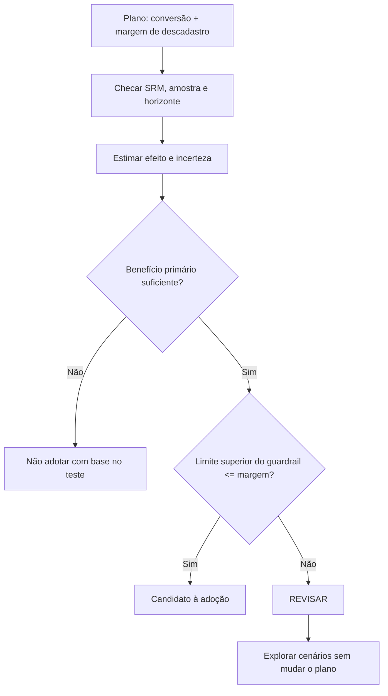
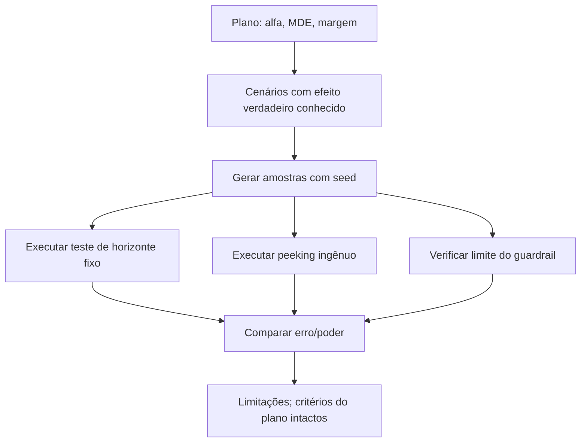

# Experimento A/B de Marketing | Ganhar conversão não basta

**Estatística aplicada · Testes de hipótese · Intervalos de confiança · Guardrails · Python · Jupyter**

> **Decisão de negócio:** a variante B melhora a conversão. Mas devemos adotá-la se também pode aumentar os descadastros?

Este projeto é uma **análise de decisão**, não uma API nem um dashboard. Um notebook reproduz o desenho, a checagem de validade, a inferência e a recomendação final. O dataset é inteiramente sintético.

## Evidência de simulação — Mac local, 14/10/2026

**23/23 testes aprovados** e três etapas executadas: análise da fixture (`make analyze`), smoke avançado (`make advanced-smoke`) e estudo Monte Carlo maior (`make advanced-design`). Saídas, configuração e riscos interpretativos: [`docs/VALIDACAO_MAC_2026-10-14.md`](docs/VALIDACAO_MAC_2026-10-14.md).

| Desenho simulado | Resultado observado |
| --- | --- |
| Horizonte fixo, sem efeito verdadeiro | **5,00%** de rejeições, 300 réplicas |
| Quatro consultas ingênuas (*peeking*) | **11,67%** de rejeições |
| Bonferroni com gasto incremental de alfa | **3,00%** de rejeições |
| Aleatorização por 25 clusters/braço | **3,33%** de falsos positivos pelo Welch por cluster |
| Ignorar esses clusters | **17,00%** de falsos positivos |
| Liberação incorreta de guardrail inseguro | **1,00%**, no cenário e nas regras simulados |

Essas frequências Monte Carlo **variam com a seed e com o número de réplicas**; não são taxas universais. A inferência sequencial usa Bonferroni conservador, não o teste O'Brien–Fleming exato. A análise original mantém a decisão **`REVISAR`**: ganhar conversão não basta para demonstrar a segurança do descadastro.

## Caso estudado

Experimento A/B simulado com **16.000 usuários** (8.000 por grupo) e **28 dias** de observação. Métrica primária: conversão. Métrica de proteção (*guardrail*): descadastro, com limite pré-definido de piora de **0,5 ponto percentual**.

### O que os dados mostraram

| Medida | Controle A | Variante B | Diferença |
| --- | ---: | ---: | ---: |
| Conversão | 7,84% | 10,08% | **+2,24 p.p.** |
| Descadastro | 1,03% | 1,49% | **+0,46 p.p.** |

- Conversão: **+28,55% de lift relativo**; IC95% da diferença aproximadamente **+1,35 a +3,12 p.p.**; `p ≈ 7,21 × 10⁻⁷`.
- Descadastro: embora a piora observada seja +0,46 p.p., o **limite superior do IC95% é +0,813 p.p.**, acima dos +0,5 p.p. tolerados pelo plano.
- Validade: SRM, tamanho amostral e horizonte foram aprovados no cenário simulado.

**Decisão do protocolo: `REVISAR`**. Há benefício estatístico na conversão, mas a margem de segurança para descadastros **não foi demonstrada**. A decisão não é “B ganhou, faça deploy”. Os intervalos apresentados são nominais, não simultâneos, e não devem ser transportados para campanhas reais.

## Por que a análise é mais do que um p-valor

1. **Planejamento antes dos resultados:** métrica primária, MDE de +1,5 p.p., α=5%, poder=80%, horizonte e guardrail.
2. **Validade da comparação:** verificações de duplicidade, alocação, SRM, amostra e período observado.
3. **Estimativa do efeito:** diferença de proporções, teste z *pooled*, IC Newcombe/Wilson.
4. **Métricas secundárias:** receita com Welch, bootstrap e ANCOVA com covariável pré-teste; ajuste de Holm.
5. **Disciplina de decisão:** limite superior do intervalo do guardrail e simulação de *peeking* para ilustrar risco de olhar os resultados repetidamente.

O plano JSON é salvo pelo script antes da geração e análise da simulação; **não é evidência de pré-registro externo**.

## Explorar o notebook

Requer **Python 3.12**. Na raiz do projeto:

```bash
python3 -m venv .venv
.venv/bin/python -m pip install -r requirements-notebook.txt
.venv/bin/python -m jupyterlab notebooks/analise_experimento.ipynb
```

Execute as células de cima para baixo. O notebook foi entregue **sem saídas gravadas** para obrigar a reprodução da análise. Ele gera suas tabelas e gráficos na própria sessão; não há HTML estático publicado.

### Rodar sem Jupyter

```bash
.venv/bin/python -m pip install -r requirements.txt
make test
make analyze
.venv/bin/python src/decision_memo.py
```

O CLI grava artefatos intermediários em `work/evaluation/`, ignorados pelo Git. `decision_memo.py` exporta um parecer Markdown opcional. Em dados externos, use `src/experiment.py --input caminho.csv --observation-days 28` e documente efetivamente a randomização e o período observado.

## Para quem lê o código

- [`notebooks/analise_experimento.ipynb`](notebooks/analise_experimento.ipynb): narrativa investigativa e decisão.
- `src/experiment.py`: funções de tamanho amostral, checagens e inferência.
- `src/decision_memo.py`: conversão opcional do resultado em parecer técnico.
- [`docs/METODOLOGIA.md`](docs/METODOLOGIA.md): premissas, fórmulas e limitações.
- `tests/`: cenários de validade, estatística e guardrails.

**Limite do estudo base:** os dados foram simulados; passar no SRM não prova randomização real e o caso original não estima ROI ou interferência de rede. A v1.6 adiciona um laboratório separado de randomização por clusters e dependência entre métricas, sem transformar a fixture original em dados observacionais reais. [Workflow de CI](https://github.com/VictorCPena/experimentacao-ab-marketing/actions/workflows/ci.yml) disponível para push, pull request ou disparo manual.

## Sensibilidade e magnitude dos efeitos (v1.4)

O teste principal toma uma decisão com base no plano; uma análise posterior **não tem permissão de alterar os critérios de adoção**. O novo [`src/sensitivity.py`](src/sensitivity.py) ajuda a explicar a consequência prática de um guardrail apertado.



### Escala hipotética para 10 mil usuários

| Medida ilustrativa, baseada na fixture | Estimativa |
| --- | ---: |
| Conversões adicionais | **~224** |
| Descadastros adicionais | **~46** |
| Conversões adicionais, IC95% nominal escalado | ~135 a 312 |
| Descadastros adicionais, IC95% nominal escalado | ~12 a 81 |

Isso **não é uma previsão de campanha**, porque o cenário é sintético e a projeção aplica taxas constantes. O limite superior de descadastros de ~81 por 10 mil excede o limite de 50 por 10 mil; por isso a decisão não é implementação automática.

**Amostra aproximada por braço para comprovar o guardrail** sob três cenários de aumento *verdadeiro assumido* (aproximação normal unilateral, alfa 5%, poder 80%):

| Hipótese de aumento em descadastro | Tamanho ilustrativo por braço |
| --- | ---: |
| 0,0 p.p. | ~5 mil |
| 0,2 p.p. | ~15 mil |
| 0,4 p.p. | ~150 mil |

Ao aproximar-se da margem de **0,5 p.p.**, a exigência de amostra aumenta fortemente. Esses valores são educativos e pós-hoc, inadequados como plano definitivo sem checar eventos raros, múltiplos indicadores e incerteza da taxa de referência.

```bash
make analyze
make sensitivity
.venv/bin/python src/decision_memo.py
cat work/evaluation/sensibilidade.json
```

A sensibilidade testa cenários de taxa-base igual a zero sem fabricar estimativas: retorna `null` com explicação quando a aproximação não é aplicável. Documento metodológico: [`docs/SENSIBILIDADE_E_RECOMENDACAO.md`](docs/SENSIBILIDADE_E_RECOMENDACAO.md).

### Decisão de negócio que este portfólio demonstra

A hipótese estatística de ganho na conversão **não é sinônimo de autorização de lançamento**. O risco do guardrail precisa ser quantificado com incerteza, e uma mudança em critérios só pode ocorrer em **novo experimento pré-planejado**. Não há demonstração de ROI em dados reais.

---

## v1.5: simular a qualidade da decisão antes de ver os dados

Os resultados da fixture indicam **REVISAR**, mas um bom projeto de experimentação também pergunta: *quão confiável seria o procedimento estatístico se repetíssemos o teste sob efeitos verdadeiros conhecidos?*

[`src/design_simulation.py`](src/design_simulation.py) usa Monte Carlo de resultados binomiais com seed fixa para explorar:

- **Erro tipo I** quando não existe efeito de conversão (teste do plano de horizonte fixo).
- **Inflação por peeking** ao declarar “significativo” se alguma das quatro olhadas tiver `p < 0,05`, sem correção sequencial — exemplo deliberadamente inadequado.
- **Poder de detecção** quando o ganho verdadeiro é o MDE pré-definido de 1,5 p.p.; também informa a fração que respeita o critério de efeito mínimo observado.
- **Segurança do guardrail** em cenários de aumento verdadeiro seguro e inseguro de descadastro: porcentagem de simulações em que o limite superior Newcombe/Wilson fica abaixo da margem.



```bash
make test
make analyze
make sensitivity
make simulate       # 2.000 simulações; 8.000 pessoas por grupo
```

O resultado fica em `work/evaluation/design_simulation.json`, junto dos cenários e **sem alterar** a decisão do teste da fixture. Em CI, a versão curta (`make simulate-smoke`) apenas verifica que a simulação é reproduzível, sem usar variação de Monte Carlo como gate arbitrário.

**Limites da simulação v1.5:** braços independentes e métricas geradas separadamente. A v1.6 traz um módulo avançado separado para métricas correlacionadas, clusters e correção sequencial conservadora; nenhum dos estudos substitui pré-registro externo ou cálculo de poder conjunto do protocolo de adoção. Consulte [`docs/SIMULACAO_DE_DECISAO.md`](docs/SIMULACAO_DE_DECISAO.md).

### Evidência de simulação do desenho

Com 2.000 réplicas de 8.000 usuários por braço e seed 42, a taxa empírica de falso positivo sob H0 foi **4,60% com teste final** e **11,35% com quatro olhadas ingênuas**. Para efeito verdadeiro de +1,5 p.p., o poder nominal do p-valor foi **92,65%**, mas apenas **50,65%** também superaram a exigência de MDE **observado**. São resultados sintéticos e não simulam a regra conjunta de adoção. Detalhes: [`docs/VALIDACAO_LOCAL_V15.md`](docs/VALIDACAO_LOCAL_V15.md).

---

## v1.6 — inferência robusta a clusters e monitoramento sequencial

A versão original trata participantes como unidades independentes. A versão avançada adiciona experimentos em que **clusters inteiros são randomizados**, as duas métricas binárias compartilham choques latentes e olhadas intermediárias gastam um **orçamento explícito de alfa**.

```bash
make advanced-smoke   # CI: 100 réplicas com clusters pequenos
make advanced-design  # estudo: 300 réplicas, 25 clusters/braço, 25 pessoas/cluster
```

O script compara inferência ingênua por usuário versus **Welch sobre médias de cluster** e analisa a probabilidade de aprovar erroneamente um guardrail inseguro. Para repetição de análises, compara horizonte fixo, *peeking* ingênuo e limiares conservadores de Bonferroni com função de gasto inspirada em O'Brien–Fleming. **Não é uma implementação do teste conjunto OBF exato.**

**Evidência sob condições sintéticas (300 réplicas, seeds 42/51):** falso positivo ignorando clusters ~17%, com cluster Welch ~3,3%; na simulação sequencial, *peeking* ~11,7% versus ~3% com alocação conservadora de alfa. Os percentuais são Monte Carlo, não estimativas de campanhas reais nem garantias de erro para outros cenários. Veja [hipóteses e método](docs/CLUSTERS_E_SEQUENCIAL.md).
