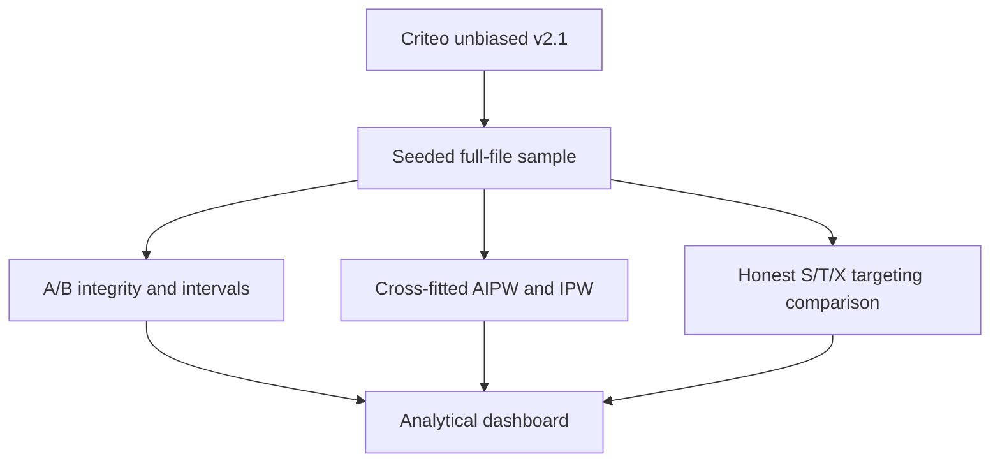

# Causal Impact & Experimentation Lab

Estimate incremental advertising visits and compare targeting policies using randomized Criteo uplift data.

**Local evidence.** Cross-fitted visit ATE of +0.870 percentage points across 139,815 sampled users. [Run record](evidence/causal_results.json).

Based on [experimentacao-ab-marketing](https://github.com/VictorCPena/experimentacao-ab-marketing/tree/e3c03307c5599778f0e5dfecfd0759996c395e2e).

## 1. Problem Statement

Estimate incremental advertising outcomes with uncertainty, then compare targeting models without confusing prediction with causal impact. The existing synthetic A/B guardrail, sequential-testing and cluster-experiment studies are retained.

## 2. Architecture



A separate real county panel supports a single-cohort DiD analysis. The causal DAG and assumptions are in `docs/causal_dag.md`; post-treatment exposure is never an adjustment covariate.

## 3. Tech Stack

Python, NumPy, Pandas, SciPy, scikit-learn, statsmodels, Streamlit, pytest. Executed optional comparisons use DoWhy, EconML and pyreadr; no PyMC dependency was added because no Bayesian model was needed for the defined estimands.

## 4. Dataset & Data Provenance

[Criteo Uplift Prediction Dataset](https://ailab.criteo.com/criteo-uplift-prediction-dataset/) unbiased v2.1; 13,979,592 source users; seed-42 Bernoulli 1% sample yielded 139,815 users. The complete file is streamed; taking the first rows is deliberately avoided. Dataset license: **CC BY-NC-SA 4.0**, distinct from software licensing. See `DATA_LICENSE.md`. No commercial data redistribution is authorized by this repository.

The real DiD case uses [did::mpdta](https://bcallaway11.github.io/did/reference/mpdta.html), a 500-county 2003–2007 teen-employment panel from Callaway & Sant’Anna (2021). The analysis uses only the 2006 treatment cohort and never-treated controls. The package distributes data under GPL (>=2); retain attribution and upstream terms. Raw data are obtained by scripts rather than bundled as a new commercial dataset.

## 5. Setup & Installation

Original validated platform: Linux x86_64 with Python 3.12. The user also executed the original 28 tests and both optional studies on an Intel Mac with Python 3.13. The UI correction adds six tests executed on Linux. A user-supplied Mac browser snapshot subsequently confirmed the dashboard render with the actual 139,815-user result and the default sample-size calculation. The captured selection was visit. See `evidence/mac-dashboard-20261109/result.json`. From this repository directory:

```bash
PYTHON_BIN=python3.12 bash scripts/setup.sh
source .venv/bin/activate
```

Direct dependencies are pinned in `requirements-portfolio.txt`. `requirements-lock.txt` records the tested Linux dependency closure. The full data path fetches public datasets and requires internet access on its first run. No paid API key or cloud billing is required.

```bash
python -m pip install -r requirements-causal-optional.txt
```

The optional profile is required for the DoWhy/EconML and real-panel studies. Core AIPW does not require those libraries. Intel macOS pins Numba 0.62.1 / llvmlite 0.45.1 and requires binary wheels for these packages, avoiding an accidental LLVM source build. These constraints apply only to that platform; Python 3.14 is outside this optional profile.

## 6. Running Locally

```bash
python -m causal_lab.data
python -m causal_lab.demo
python -m streamlit run causal_lab/dashboard.py --server.address 127.0.0.1
```

With the optional dependencies installed, run the estimator comparison and the real-panel case separately.

```bash
python -m causal_lab.library_comparison
python -m causal_lab.real_did
```

A local complete Criteo gzip can be supplied with `causal_lab.data --input PATH`. The sampler writes row IDs before sampling, checks duplicates and records raw/sample SHA256. It excludes `exposure` from model inputs.

## 7. Testing

```bash
python -m pytest -q
python -m ruff check causal_lab tests/test_pro_causal.py
```

Tests cover randomized known-effect recovery and interval inclusion, a known-truth DiD simulation, invalid panels and duplicate units, Holm correction, uplift ranking behavior, and the preserved A/B/cluster/sequential tests. Known-truth test success does not establish every finite-sample interval has nominal coverage. The dashboard is a local analytical application, not an image mockup. Streamlit AppTest exercises exact slider precision, a changed MDE, and conversion selection while fixed-primary-outcome panels remain labeled visit. The planning function validates inputs and uses the ceiling so the integer sample size reaches the requested approximate power.

## 8. Performance Results

On the real 139,815-user sample, the three-fold cross-fitted visit ATE was **0.008703**, 95% interval **[0.006157, 0.011249]** in absolute probability units. This is a sampled published-trial ITT estimate, not a client revenue result. See the [CATE calibration chart](evidence/cate_calibration.png) and [statistical results](evidence/causal_results.json) for frequentist outcomes, IPW, overlap, balance, Holm, planning, bias-tipping scenarios, held-out quintiles and fixed-model bootstrap AUUC uncertainty. DoWhy/EconML use a separate reproducible 20,000-row subsample; their point estimates are not directly interchangeable with full-sample AIPW.

## 9. Engineering Decisions

Randomization integrity cannot be proven by covariate balance. Exact intended allocation is unavailable: the published rounded 0.85 treatment ratio is not used to certify SRM. Primary real-data outcome is visit; conversion is secondary and rare. The A/B selector changes only its own panel. AIPW, heterogeneity and targeting panels explicitly retain the primary outcome. Planning uses probability units: MDE 0.005 means 0.5 percentage points. At baseline 0.05, two-sided alpha 0.05, power 0.80 and equal allocation, the requirement is 31,218 observations per arm (normal approximation, rounded up). AIPW uses out-of-fold propensity and outcome models. S/T/X meta-learners are fitted before their holdout targeting scores are evaluated. Predictive AUC/Brier and causal gain are reported separately. Heterogeneity is exploratory; anonymized features do not identify deployable business segments.

## 10. Failure Handling

Invalid schema, duplicate experimental units, non-finite values and invalid panel structures raise errors. Positivity diagnostics and clipped-weight fraction are recorded. Bootstrap intervals condition on fitted models and exclude model-training uncertainty. DiD rejects unbalanced/invalid two-period designs; the real panel's state assignment level is used for clustering.

## 11. Limitations

No advertising spend, revenue or unsubscribe outcome is available in Criteo. The project therefore refuses to certify profitability or real business safety guardrails. Existing synthetic guardrails remain clearly labeled. The real DiD case has **three treated states**: conventional state-cluster intervals are displayed as non-confirmatory; pre-period placebo differences cannot prove parallel trends. No cross-sectional Criteo DiD is performed. No unsupported claim of causal robustness to arbitrary unmeasured confounding is made. The dashboard does not implement an experiment assignment service.

## 12. Future Improvements

Blind CATE replication across independent trials; wider nuisance-model sensitivity; wild-cluster/randomization inference for the policy panel; a genuinely measured cost and safety outcome; prospectively specified experimental decision policies. Review dataset reuse terms before any commercial deployment.

The [original synthetic workflow guide](docs/README_ORIGINAL.md) remains available.
