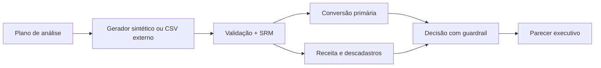

# Arquitetura e evidências

**Escolhas:** unidade de randomização é usuário; planejamento prévio de MDE e tamanho;
IC Newcombe/Wilson, Welch, bootstrap e ajuste com covariável pré-tratamento;
Holm em métricas secundárias; separação entre significância e segurança.
**Limite:** resultados de experimentos sintéticos sob desenho assumido.
**Evidências:** `analise.json`, `PARECER_DECISAO.md`, testes e CI.
