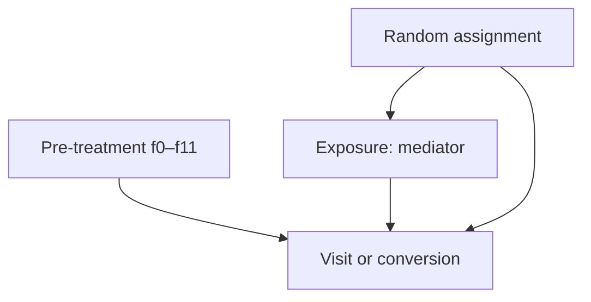

# Causal design

The randomized intention-to-treat estimand is E[Y(1)-Y(0)] in the sampled trial population. Exposure is post-assignment and is excluded from adjustment. Observed balance cannot prove randomization. Propensity modeling is a robustness comparison; the exact trial assignment probability is not provided. Cross-fitting prevents fitting nuisance functions on the same rows used to evaluate their scores. Uncertainty for CATE is approximate and exploratory. Two-period DiD is demonstrated separately on a labeled simulation, not on Criteo. No causal effect of real policy is claimed by the simulation.
